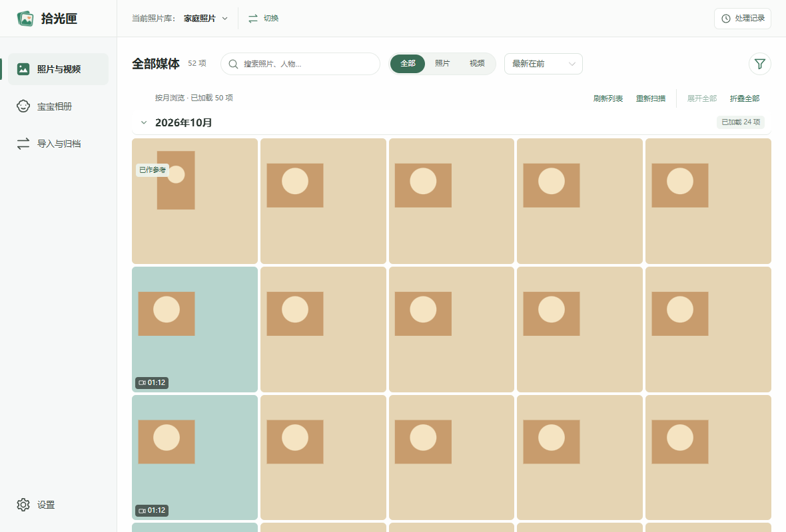
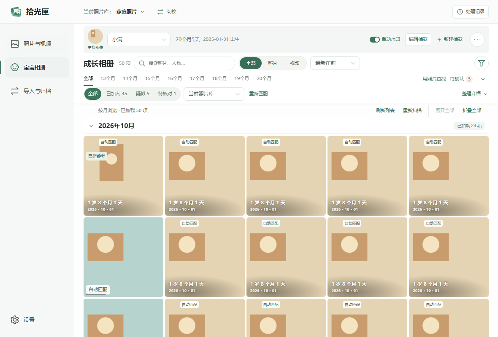
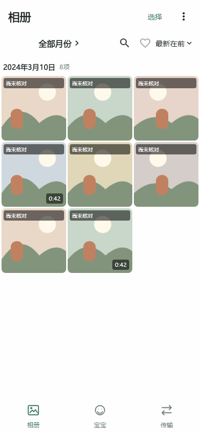

# 拾光匣 · MomentNest


**把家庭照片收好，让成长有迹可循。**

拾光匣是一款面向家庭的本地照片与视频管理工具。它帮助你整理电脑图库、建立宝宝成长相册，并通过局域网将 Android 手机上的原文件备份到 Windows 电脑。

相册与人脸辅助整理在本机运行。手机和电脑各自维护宝宝记录，电脑连接用于原文件上传和备份核对；当前不提供宝宝相册跨设备同步或从电脑下载原文件。

## 平台与发布状态

| 平台 | 当前支持 |
|---|---|
| Windows x64 | Electron 桌面应用，以完整便携目录交付，无需安装 Node.js 或 Flutter |
| Android 8.0 / API 26 及以上 | Flutter 手机应用，APK 按版本、架构和签名类型区分 |
| iOS、macOS、Linux | 尚未提供经过验收的发行版本 |

源码仓库为 [YouHanHan/momentnest](https://github.com/YouHanHan/momentnest)，采用 [MIT 许可证](LICENSE)，访问范围以 GitHub 仓库设置为准。尚未发布 GitHub Release；发布后从 Releases 获取安装包，GitHub 自动生成的源码 ZIP 不包含可直接运行的 Windows 应用。源码版本以 [桌面配置](apps/desktop/package.json) 和 [手机配置](apps/mobile/pubspec.yaml) 为准，具体构建与设备验证见 [验收记录](docs/verification.md)。

## 可以做什么

- **管理家庭图库**：按月份浏览照片和视频，搜索、收藏、查看拍摄信息；支持已有目录索引与复制归档。
- **建立成长相册**：创建宝宝档案，明确选择参考人脸，使用本地模型辅助查找，并人工确认已加入、疑似和待核对照片。
- **保存成长水印副本**：叠加成长年龄和拍摄日期，单张或批量导出新的 JPEG；日常预览开关沿用本机设置。
- **传输完整原文件**：Android → Windows 局域网 HTTPS 上传，以完整 SHA-256 和大小核对，支持暂停、重试及断点接续。
- **核实备份状态**：区分当前照片库的有效保存回执、其他历史目录已有文件、未传入与需补传；以接收端确认保存为成功依据。

普通预览读取原文件，保留完整画面与比例；读取失败会明确提示。应用不提供删除照片或视频的能力，原文件、归档副本、水印副本和失败导出文件均保留。

Android 宝宝整理与上传核对的完整内容指纹改由原生工作线程计算，使用固定大小读块并检查读取前后的文件状态，减少逐张原图的 Dart 哈希开销。已有指纹、人脸缓存、暂停续传和人工归属继续复用，原图预览与识别模型保持现有质量。具体验证与性能测量范围见 [验收记录](docs/verification.md)。

## 界面演示

以下截图来自当前界面代码，使用合成图片、虚构档案与测试接口，不包含私人照片或配对信息。它们用于展示界面，不代表真机安装或实际人脸识别验收。生成方式见 [截图说明](docs/screenshots/README.md)。

Windows 家庭图库：



Windows 宝宝成长相册与水印：



Android 相册与宝宝相册：

 

## 第一次使用

1. 解压完整 Windows 程序目录，运行其中的 EXE。在电脑上登记照片库，并选择新照片保存位置。
2. 安装适合手机架构与现有签名身份的 APK，授权需要访问的相册。将手机和电脑连接到同一个 IPv4 子网的普通局域网。
3. 在电脑显示配对二维码，手机扫码或粘贴配对信息。选择照片或按月备份，核对目标与日期归档规则后开始上传；收到保存回执后才算完成。
4. 需要成长相册时，在各自设备建立宝宝档案并选定参考人脸。检查疑似与待核对结果，再制作需要的水印副本。

上传时保持手机应用在前台，电脑应用保持运行。VPN、跨子网及仅移动数据环境会被拒绝；访客 Wi-Fi 或无线隔离可能阻止两端连接。详细操作见 [使用说明](docs/user-guide.md)。

## 安装身份与数据

MomentNest 使用独立 Android 应用标识 `dev.momentnest.app`、正式证书、平台通道和本机数据库。Windows 使用用户目录下的 `.momentnest`。首次使用重新登记照片库、建立宝宝档案并配对；原照片和视频可重新授权与索引。

当前 APK 按新应用安装，不承接其他应用身份的旧记录。正式版与调试版签名不同，后续升级使用相同渠道及证书。详见 [品牌与应用身份](docs/branding.md)。

## 当前限制

- 人脸查找是辅助结果，不能保证全部识别正确；人工加入和排除优先。
- 不提供持续后台上传服务，手机进入后台后保存进度并暂停；宝宝整理也不承诺锁屏持续运行。
- 不提供云账号、公网中转、自动更新或宝宝相册跨设备同步。
- 视频支持原文件传输和平台可解码的预览，当前不导出视频成长水印。
- HEIC 与特殊视频编码的预览受平台解码能力影响，失败时不会用缩略图代替原图。
- 单个网络传输文件上限为 2 GiB；历史目录匹配不代表当前目标库已经保存。
- 软件内没有完整的本机状态备份与还原入口；请妥善保留数据目录及手机应用数据。

## 从源码运行

桌面开发需要 Node.js 22.12 及以上版本，建议使用受支持的 LTS。Android 开发另需 Flutter、Android SDK 与 JDK。使用现有锁文件安装依赖，首次准备依赖和公开模型需要联网；发布程序的整理与识别使用包内模型。

```powershell
npm.cmd ci
npm.cmd run models:setup
npm.cmd run media:build -- -Python <Python可执行文件路径> -Jobs 2
npm.cmd run dev
```

桌面媒体工具首次需要 Python 3，从固定源码编译；编译器等工具只准备到项目缓存，内存较少时使用 `-Jobs 1`。手机开发先执行 `npm.cmd run mobile:deps`，再执行 `npm.cmd run mobile:dev`，不需要构建 Windows 媒体工具。模型版本、大小及 SHA-256 固定在仓库清单中，准备脚本不会自动更新模型或许可文件。环境基线、模块边界和首次构建检查见 [开发说明](docs/development.md)。

交付打包使用 `npm.cmd run desktop:package` 与 `npm.cmd run mobile:apk:all`，自动递增补丁版本；同轮调试和正式 APK 共用版本及构建号。旧包保留，不通过改文件名冒充新版本。Windows 打包校验新媒体工具及完整对应源码，将源码 ZIP 放在便携目录旁；对外分发时同一 Release 同时提供程序和源码资料，具体要求见 [二进制发行许可核查](docs/binary-distribution.md)。

## 文档

| 文档 | 用途 |
|---|---|
| [使用说明](docs/user-guide.md) | 相册、传输、成长整理及常见问题 |
| [开发说明](docs/development.md) | 环境、运行、测试、构建与签名 |
| [隐私与数据](docs/privacy.md) | 权限、数据位置、网络与保存边界 |
| [品牌与应用身份](docs/branding.md) | 两端标识、安装包命名与数据位置 |
| [GitHub 发布准备](docs/github-release.md) | 上传范围、仓库设置、发布资料与检查清单 |
| [产品设计](docs/product-design.md) / [接口说明](docs/api.md) | 行为约束与实现边界 |
| [更新记录](CHANGELOG.md) / [验收记录](docs/verification.md) | 变更与验证证据 |

## 授权与反馈

项目自有代码采用 [MIT 许可证](LICENSE)，允许使用、修改、商用和再分发，须保留版权与许可声明；软件按许可证中的「按原样」条款提供。第三方软件和模型适用各自的许可证，见 [第三方许可说明](THIRD_PARTY_NOTICES.md)。npm 的 `private` 配置只阻止 npm 发布，不决定 GitHub 可见性，也不限制 MIT 授予的权利。

欢迎通过 Issues 反馈或提交 Pull Request。请附平台、版本、复现步骤与脱敏日志，不要提交私人照片、人脸特征、配对二维码、令牌或签名文件。贡献与私密安全报告方式见 [贡献说明](CONTRIBUTING.md) 和 [安全说明](SECURITY.md)。

维护者可运行 `npm.cmd run opensource:check` 生成本地整备报告，核对源码与本地 Git 历史中的常见敏感信息、授权元数据及运行依赖许可缺口。报告的范围与人工待办见 [发布准备](docs/github-release.md)。

文档按当前应用行为维护，构建与设备验证见 [验收记录](docs/verification.md)。
